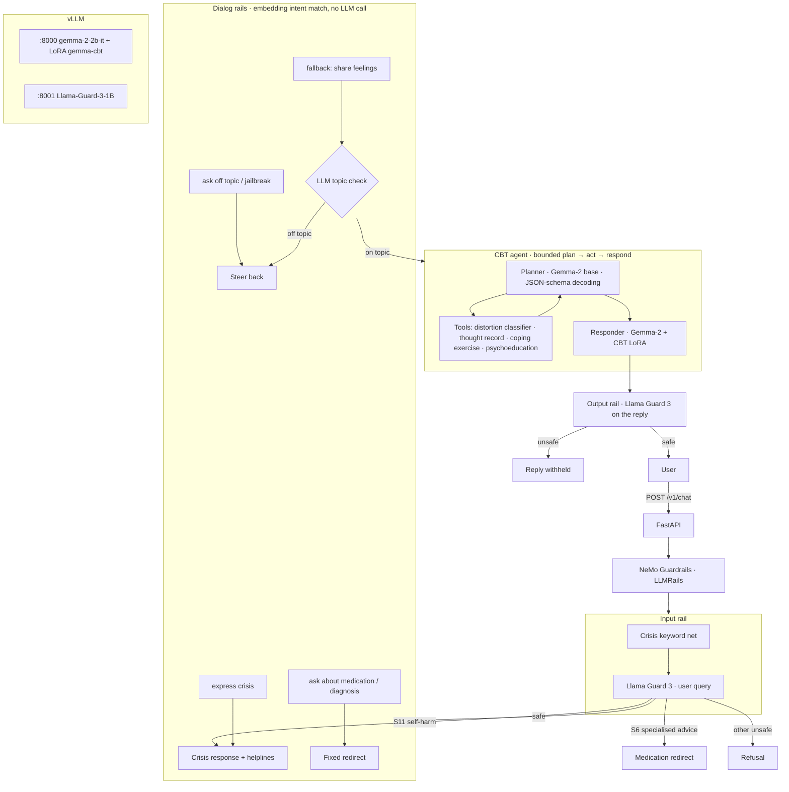

# Gemma-2 Anxiety Support System

A CBT (Cognitive Behavioral Therapy) conversational assistant for anxiety, built around a
**QLoRA fine-tuned Gemma-2** and a **layered safety stack** (NVIDIA NeMo Guardrails + Meta Llama Guard 3).
An **agentic session controller** plans each turn (CBT phase + tool use) before the fine-tuned
model writes the reply. Exposed as a **FastAPI** service, with **vLLM** serving and **Docker Compose** deployment configured.

> **Status:** QLoRA training is done (results below). The safety pipeline and API are tested end to end against
> simulated model servers. **Not yet validated on a GPU:** vLLM serving, and the Llama Guard 3 model itself
> (pending licence access), so the full-stack safety and response-quality evals have not been run yet.

> **Not a medical device.** This is a self-help / research project. It does not diagnose, does not
> give medication advice, and always escalates crisis disclosures to human helplines
> (India: Tele-MANAS 14416, emergency 112).

For how a message and a training conversation move through the code, and the implementation details behind
it, see **[docs/PROJECT_WALKTHROUGH.md](docs/PROJECT_WALKTHROUGH.md)**.

## Architecture



| Layer | What it does | Why |
|---|---|---|
| Crisis keyword net | High-precision regex for explicit self-harm phrasing | Deterministic, zero latency, can't be talked around |
| Llama Guard 3 (input) | MLCommons hazard taxonomy S1–S14 on the user query | General-purpose moderation. **S11 → crisis support, not a refusal.** S6 → medical redirect |
| NeMo dialog rails | Embedding-only intent matching to fixed, reviewed replies (crisis, medication, diagnosis, off-topic, jailbreak) | Conversational steering without an LLM call |
| LLM topic check | One short structured call, only on messages that fall through to the agent | Embedding match can't cover open-set off-topic requests (cost-aware cascade) |
| CBT agent | Plans phase and tools, keeps a per-session thought record | Structured CBT (situation → thought → distortion → evidence → reframe → action) instead of free chat |
| Llama Guard 3 (output) | Moderates the generated reply (Agent role) | Catches unsafe generations from the fine-tuned model |
| Fail-closed | If Llama Guard is unreachable, the turn gets a safe fallback | Safety over availability |

## Repository layout

```
src/anxiety_support/
  api/main.py           FastAPI service (/v1/chat, /v1/sessions/{id}, /healthz, /readyz)
  safety/rails.py       NeMo Guardrails pipeline; registers Llama Guard, crisis, topic, agent actions
  safety/llama_guard.py Llama Guard 3 prompt builder, parser, client (vLLM /v1/completions)
  safety/crisis.py      keyword net + crisis response (region-specific helplines)
  safety/topic.py       second-tier LLM topic check
  agent/cbt_agent.py    plan → act → respond loop with structured outputs
  agent/tools.py        distortion classifier, thought-record extractor, coping exercises, psychoeducation
  agent/state.py        session store, CBT phases, thought record
  llm_client.py         OpenAI-compatible client; Gemma-2 system-prompt folding
guardrails/             NeMo config.yml + Colang flows (rails.co)
training/               prepare_data.py (CACTUS → Gemma-2 chat), train_qlora.py, merge_adapter.py
configs/train_qlora.yaml
evaluation/             eval_safety.py (ablation), eval_responses.py (base vs fine-tuned), labelled prompt sets
notebooks/              colab_train_and_eval.ipynb (train → serve → evaluate on a Colab GPU)
docker/, docker-compose.yml
tests/                  49 tests, incl. the real NeMo runtime and a stub vLLM HTTP server
```

## Fine-tuning

**Data:** [CACTUS](https://huggingface.co/datasets/LangAGI-Lab/cactus) (Lee et al., 2024), 31,577 synthetic
multi-turn CBT counseling dialogues, each with the client's automatic thought, distortion labels and CBT technique.
`training/prepare_data.py`:

- keeps the **13,101 anxiety-focused** cases (intake "Presenting Problem" mentions anxiety, worry, panic or fear)
- maps `Counselor`/`Client` turns to `assistant`/`user`, merges same-speaker runs, enforces Gemma-2 alternation
- scrubs the client's name from counselor turns, so the model doesn't learn to invent names
- folds the CBT system prompt into the first user turn. Gemma-2 has no system role, and inference does the same
- split: 12,315 train / 393 eval / 393 test conversations (mean 29 turns)

**Method:** QLoRA with TRL `SFTTrainer` + PEFT. 4-bit NF4 base with double quantisation, LoRA r=16 / α=32 on all
attention and MLP projections, paged 8-bit AdamW, cosine LR 2e-4, gradient checkpointing, max length 2048.
**Loss only on counselor turns** (`assistant_only_loss`), via a Gemma-2 chat template with `` markers
that renders the standard Gemma-2 turn layout (`<start_of_turn>user/model … <end_of_turn>`, unit-tested), and the
script asserts the assistant-token mask is non-trivial before training starts. Eval loss is measured **before** training (the base
model, since LoRA B starts at zero) and after, on the same held-out conversations.

## Evaluation

### Fine-tuning: base vs QLoRA adapter (`evaluation/results/training_metrics.json`)

Run: 1,000 anxiety-focused training conversations, 1 epoch (63 optimiser steps), 34.5 min on a single Colab **T4**
(4-bit NF4 base, fp16 autocast). Both models were scored on the same 200 held-out conversations, with loss on counselor
turns only:

| Held-out CBT dialogues (n=200) | Base Gemma-2-2B-it | + CBT QLoRA adapter | Change |
|---|---|---|---|
| Eval loss | 1.921 | **1.092** | −43.1% |
| Perplexity | 6.83 | **2.98** | −56.3% |
| Next-token accuracy (counselor turns) | 52.7% | **67.1%** | +14.4 pts |

This is an in-distribution result: the eval conversations are synthetic CACTUS dialogues, like the training data. It
shows the adapter learned the CBT counselor style. It is not evidence of clinical quality (see Limitations). Training on
all ~12.3k conversations is a config change (`max_train_samples: null`).

### Safety layers on CPU (reproducible: `python evaluation/eval_safety.py --target rails-offline --split test`)

The "rails-offline" target runs the **keyword net + NeMo dialog rails only**, with Llama Guard and the LLM topic tier
stubbed out. It shows what the CPU-only layers catch by themselves on the 65-prompt held-out test set:

| Metric (held-out test, n=65) | Keyword + embedding rails only |
|---|---|
| Crisis recall | 75.0% (9/12) |
| Medication / diagnosis redirect | 100% / 100% |
| Jailbreak steering | 33.3% |
| Off-topic steering | 0% (by design, handled by the LLM topic tier) |
| Harmful-request blocking | 0% (by design, handled by Llama Guard) |
| Benign false-positive rate | 10.0% (2/20) |
| Rails latency p50 | ~57 ms on CPU |

What this showed:
- **Embedding-only steering doesn't generalise to open-set categories.** It works for narrow intents (medication,
  diagnosis) but not for off-topic or jailbreak phrasings it hasn't seen. That is why the system adds Llama Guard and
  an LLM topic tier rather than relying on Colang examples.
- **NeMo's similarity threshold is not cosine.** NeMo scores `1 − √(2 − 2·cos)/2` (Annoy-compatible), so a
  threshold of 0.40 actually means cosine ≈ 0.28. The threshold was tuned on the **dev** split only (cosine 0.40 → NeMo
  0.45: best dev accuracy with zero benign false positives).
- Transparency note: the test split was also run once with the mis-scaled threshold (0.40 NeMo score), giving 66.2%
  accuracy and 15% benign false positives. The change to 0.45 was driven by the dev set and the scoring-function
  finding, and no further tuning was done after looking at test.

### Requires a GPU run (notebook Part B). Numbers are written to `evaluation/results/`

| Eval | Command | Output |
|---|---|---|
| Llama Guard alone (ablation) | `eval_safety.py --target guard` | `safety_guard_test.md` |
| Full stack | `eval_safety.py --target api` | `safety_api_test.md` |
| Response quality: base vs fine-tuned (similarity to real counselor turn, question style, optional pairwise LLM judge in both orderings) | `eval_responses.py` | `responses_eval.md` |

_Not filled in yet: these need notebook Part B (vLLM serving the base model, the adapter and Llama Guard 3)._

## Quickstart

**Tests (CPU, no GPU or tokens needed):**
```bash
python -m venv .venv && source .venv/bin/activate   # Windows: .venv\Scripts\activate
pip install -e ".[dev]"
pytest -q
python evaluation/eval_safety.py --target rails-offline --split dev
```

**Train + evaluate on Colab:** open `notebooks/colab_train_and_eval.ipynb`, add an `HF_TOKEN` secret, and accept the
Gemma-2 and Llama Guard 3 licences on Hugging Face.
**Serve with Docker (one GPU ≥ 16 GB, NVIDIA Container Toolkit):**
```bash
export HF_TOKEN=...
# put the trained adapter at ./outputs/gemma2-cbt-qlora/adapter
docker compose up --build
curl -s localhost:8080/v1/chat -H 'content-type: application/json' \
     -d '{"message": "My placement interview is tomorrow and I am sure I will mess it up"}'
python scripts/chat_cli.py --trace
```

Each `/v1/chat` response includes the `route` taken (`cbt_agent`, `crisis`, `medication`, `diagnosis`, `off_topic`,
`jailbreak`, `blocked_input`, `blocked_output`), both Llama Guard verdicts, the agent's phase and tool steps, the
current thought record, and the latency.

## Design decisions

- **QLoRA on a 2B model:** fits a free-tier 16 GB GPU for training. The adapter (~20M trainable parameters, under 1% of the model) is served with vLLM
  **multi-LoRA**, so one process serves both the base model (planner, topic check) and the CBT adapter (responder) on
  shared weights.
- **Structured outputs for the agent:** the planner and the extraction tools use vLLM JSON-schema guided decoding
  (Pydantic schemas). Invalid output degrades to "reply without a tool", so the user always gets an answer. The tool
  loop is bounded (`AGENT_MAX_STEPS`).
- **Llama Guard prompt built explicitly:** the Llama Guard 3 format is built in code and sent to `/v1/completions`,
  which keeps the taxonomy under our control and behaves the same for the 1B and 8B checkpoints.
- **Crisis ≠ refusal:** in a mental-health product, blocking a suicidal user is a harm. Three independent detectors
  (regex, Llama Guard S11, dialog rail) all lead to a supportive reply with helplines. Over-escalating hyperbole
  ("I could just die") is accepted as the safer failure.
- **Fail closed:** moderation outages produce a safe fallback reply, never an unmoderated one.

## Limitations

- CACTUS is **synthetic** (LLM-generated) counseling data. It is not real therapy transcripts and has not been
  clinically validated.
- The safety prompt sets (28 dev / 65 test) are small and were written by the project author, so they are a
  regression suite, not a benchmark.
- LLM-as-judge scores carry judge bias. The judge runs pairwise in both orderings and counts only consistent verdicts.
- Sessions are in memory (single replica). Use Redis for horizontal scaling. English only.

## Licences

Code: Apache-2.0. Gemma-2 is subject to the [Gemma Terms of Use](https://ai.google.dev/gemma/terms) and Llama Guard 3
to the Llama 3 Community License. The CACTUS dataset is listed under GPL on the Hugging Face Hub. This repository does
not redistribute it; `prepare_data.py` downloads it.
